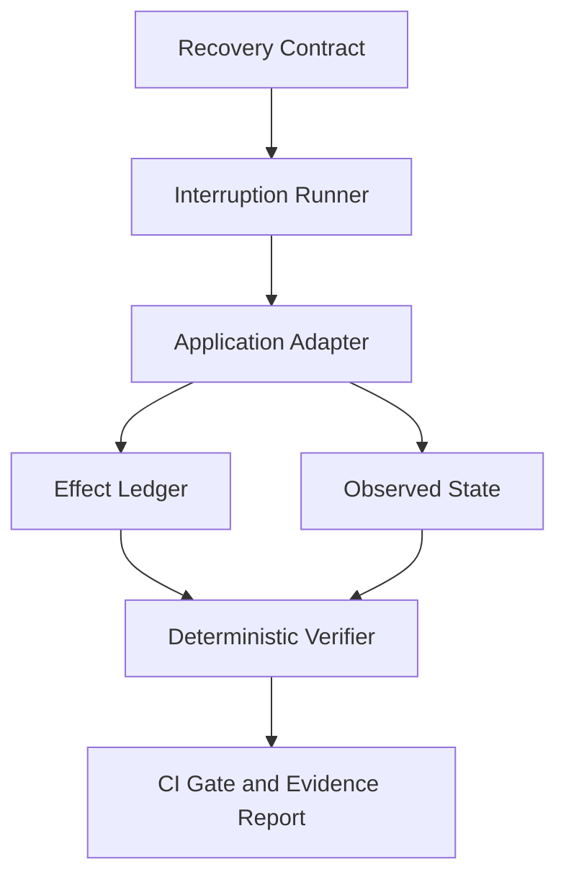

# User Journey Recovery Testing (SecondChance Lab)

**Chaos testing for critical user journeys: interrupt a flow like checkout at the worst moment and prove it still completes safely, clearly, and exactly once.**

[](https://github.com/MadanMohan0537/user-journey-recovery-testing/actions/workflows/ci.yml)
[](LICENSE)
[](package.json)
[](tsconfig.json)

*Previously named `secondchance-lab`. The npm package is still `secondchance-lab` and the CLI is `secondchance`.*

## Why this matters for users

The worst moments in a product are when a user doesn't know whether something happened: "Did my payment go through? Should I click again?" A blind retry can charge twice or send a duplicate invite; an unclear screen erodes trust even when the backend succeeded. This project treats **recovery from interruptions as a product requirement** that can be written down, reviewed, and tested in CI, not just an engineering detail.

**Who it is for:** product managers and engineers who own critical journeys (checkout, sign-up, invitations, agent tool calls) and want evidence that those journeys survive refreshes, timeouts, and duplicate events.

**Headline metrics**, printed for each run of the included simulations: safety violations, recovery success rate, and outcome-certainty rate. In the checkout adapters, certainty is true only when the visible payment status is `paid`. That flag does not mean the screen disclosed how many charges were recorded.

---

Most end-to-end tests answer one question: **Did the happy path finish?**

Ambiguous outcome windows look like this:

- a payment request reached the server, but the response timed out;
- an invite succeeded, but the page displayed an error;
- a user refreshed while a record was being created;
- a webhook arrived twice or out of order;
- an agent tool call completed, but the agent never received confirmation.

Blind retries inside them create duplicate charges, repeated invitations, orphaned records, and users asking, “Did it go through?”

The checkout simulation is what CI actually runs. Webhook ordering and agent-tool checks exist as in-process libraries, not as additional CI journeys. The tool turns a recovery promise into a contract, runs each declared interruption window as its own scenario, records the side effects the adapter reports, and evaluates deterministic invariants.

> The explorer may be intelligent. The verifier must be deterministic.

## Run the demo, then challenge its assumptions

```bash
npm install
npm run check
npm run demo
```

Read the generated report alongside the recovery contract. The included adapters demonstrate interruption and recovery behavior through simulations; they do not establish exactly-once effects in your live payment or backend system.

Before building a real adapter, define how it observes committed effects, reuses idempotency keys, and distinguishes a pending request from a completed one. Start with [example contracts](examples/), [CLI implementation](src/cli.ts), [contribution guidance](CONTRIBUTING.md) and [security boundaries](SECURITY.md).

## What is working today

This repository contains an executable backend-first foundation, not a landing-page prototype.

| Capability | Status |
|---|---|
| Recovery Contract validation | Implemented |
| Natural-language contract drafts | Implemented |
| Contract composition | Implemented |
| Contract linter and safe fixes | Implemented |
| Semantic contract diffing | Implemented |
| Deterministic interruption case listing | Implemented |
| Static recovery-coverage scoring | Implemented |
| Contract mutation-testing primitives | Implemented |
| Versioned template-registry primitives | Implemented |
| Effect Ledger | Implemented |
| Exactly-once, range, and state verification | Implemented |
| Concurrent interruption sweeps | Implemented in the runner (`concurrency` 1–10). CLI `demo` and `run` execute windows one at a time |
| Markdown evidence reports | Implemented |
| Vulnerable and resilient checkout simulations | Implemented |
| In-process API fault plans and provider mocks | Implemented core |
| In-memory event ordering, deduplication, and buffering | Implemented core |
| In-process background-job retries and dead-letter behavior | Implemented core |
| Time-travel snapshots and causal state graphs | Implemented core |
| Runtime matrices, interrupted load, and offline reconciliation | Implemented core |
| Recovery SLOs, regression bisect, environment drift, and orphan detection | Implemented core |
| In-memory replay tokens, PR comment text, badge SVG, postmortems, and digests | Implemented core |
| Feature-flag plans, recovery playbooks, and incident-to-contract conversion | Implemented core |
| Multi-actor, agent-tool, and state-machine verification | Implemented core |
| TLA+ sketch export, recovery debt, deploy gates, benchmark, journey-twin simulation, and in-memory Recovery API | Implemented core |
| Credentialed Stripe/Auth0/SendGrid/Sentry/Datadog adapters | Not in this repository |
| Real Playwright browsers and React Native/Flutter device farms | Not in this repository |
| Hosted dashboard, marketplace, Slack/Teams apps, and public service | Not in this repository |

The project deliberately distinguishes implemented behavior from roadmap intent. See the [complete product roadmap](docs/roadmap.md).

### What “implemented core” means

An implemented core has a typed API, deterministic behavior, automated tests, and exports through the package entry point. These cores run in-process. They do not open a network server, call a vendor, or drive a browser.

Rows marked “Not in this repository” have no adapter, interface, or hosted app in this tree. A credentialed vendor client, a real browser or device farm, and a hosted service would each be new work.

`fuzz` lists fault and timing permutations; it does not execute them. `coverage` scores windows and families declared on the contract. An enabled window counts as covered even when no scenario has run. `contractToTla` writes a short TLA+ sketch; nothing in this repository model-checks it. `RecoveryApi` is an in-memory query class, not an HTTP service.

## How it works



The architecture separates five responsibilities:

1. **Recovery Contract** describes the action, interruption windows, permitted effects, state assertions, and failure budget.
2. **Runner** executes every selected interruption scenario independently. The library can run up to 10 windows at a time; the CLI does not set that option.
3. **Application Adapter** drives the system under test and observes its state. The adapters in this repository are simulations.
4. **Effect Ledger** stores side effects the adapter appends, such as a charge, invite, email, order, or reversal.
5. **Verifier** is a pure function of the contract, the ledger, the observed state, and the adapter’s `recovered` and `outcomeCertain` flags. It does not call a model. Those two flags are only as trustworthy as the adapter that sets them. Effect counts are computed from the ledger. State assertions are recorded in the report and do not, by themselves, change the pass bit.

## Quick start

Requirements: Node.js 20 or newer.

```bash
git clone https://github.com/MadanMohan0537/user-journey-recovery-testing.git
cd user-journey-recovery-testing
npm install
npm run check
```

Run the deliberately vulnerable checkout:

```bash
npm run demo
```

The command is expected to fail. It writes `.secondchance/report.md`. On the included checkout simulation it prints `3 safety violation(s), 100% recovery, 25% certainty`. Recovery stays at 100% because the vulnerable adapter marks a window recovered whenever one order was created, including windows that charged twice. The report shows four windows:

- `duplicate_click` records two `charge.succeeded` effects while the visible status is still `paid` (the certainty flag stays true);
- `after_send_before_ack` and `after_commit_before_response` each record two charges and show `failed_try_again`;
- `refresh_during_processing` leaves the visible status `unknown` while the backend status is `paid`.

Now run the idempotent implementation:

```bash
npm run dev -- run examples/checkout.recovery.yml \
  --adapter resilient \
  --out .secondchance/resilient-report.md
```

That run passes: `0 safety violation(s), 100% recovery, 100% certainty`. `run` defaults to the `resilient` adapter. The only other adapter name the CLI recognizes is `vulnerable`; any other `--adapter` value is also treated as `resilient`. `demo` always uses `vulnerable`.

## A Recovery Contract

Contracts live beside application code and receive normal pull-request review.

```yaml
version: 1
name: checkout-exactly-once

action:
  name: submit-payment
  idempotencyKey: checkout-session-id

windows:
  - id: after_send_before_ack
    family: request
  - id: after_commit_before_response
    family: request
  - id: refresh_during_processing
    family: session

invariants:
  effects:
    - effect: charge.succeeded
      exactly: 1
    - effect: order.created
      exactly: 1
  state:
    - path: visible.paymentStatus
      operator: equals
      value: paid

failureBudget:
  safetyViolations: 0
  recoverySuccessRate: 1
  outcomeCertaintyRate: 1
```

The snippet is a shortened illustration. The contract CI runs is the [working checkout contract](examples/checkout.recovery.yml). That file also includes `duplicate_click`, window descriptions, and a `backend.paymentStatus: paid` assertion.

Effect counts are the safety gate. The pass/fail decision then requires the failure budget: safety violations at or below the budget (here, zero), and recovery and certainty rates at or above their budgets (here, both 1). Recovery and certainty come from the adapter’s flags. State assertions are checked and listed in the report; a state mismatch alone does not fail the command. See the [contract reference](docs/contracts.md).

## Authoring contracts

Generate a draft from product language:

```bash
npm run dev -- generate \
  "User invites a teammate; invite sends exactly once; form survives reload" \
  --out examples/invite.recovery.yml
```

This description names a cardinality (“exactly once”) and an interruption (“reload”), and it does not name backend evidence. The command still writes the file, prints `QUESTION: Which backend state proves that the action completed?`, and exits non-zero. The draft also fills fields the question does not cover: an idempotency key of `${intent.id}`, effect `invite.sent` exactly once, a state path `backend.invite.sent.status` equal to `succeeded`, and a failure budget of `0 / 1 / 1`. Some other assumptions are printed as `ASSUMPTION:` lines (for example, a default timeout window, or reading “at most once” as `max: 1`). Read the written YAML before treating it as a guarantee.

Review the contract’s quality. `--fix` only fills a missing description and, when some effect is `exactly: 1`, sets the safety budget to zero. It does not add windows, idempotency keys, or state assertions.

```bash
npm run dev -- lint examples/invite.recovery.yml
npm run dev -- lint examples/invite.recovery.yml --fix
```

The repository ships one contract, `examples/checkout.recovery.yml`. Compose and diff take paths you supply. After the generate command above has written the invite file, this composition runs:

```bash
npm run dev -- compose \
  examples/checkout.recovery.yml \
  examples/invite.recovery.yml \
  --out examples/combined.recovery.yml
```

There is no `examples/base.recovery.yml` or `examples/email.recovery.yml` in the tree. The general form is:

```bash
npm run dev -- compose <base.yml> <extension.yml> [--out combined.yml]
npm run dev -- diff <before.yml> <after.yml>
```

`diff` compares two contract files you already have. It does not look for `before.recovery.yml` or `after.recovery.yml` unless you pass those paths.

Enumerate fault and timing permutations, then score the contract’s declared windows:

```bash
npm run dev -- fuzz examples/checkout.recovery.yml --limit 50
npm run dev -- coverage examples/checkout.recovery.yml
```

`fuzz` does not execute the permutations. The checkout contract has four windows, so the full list is longer than 50; `--limit 50` stops early. `coverage` reports which of `request`, `session`, and `environment` the file declares. The checkout contract is missing `environment`.

## CLI reference

| Command | Purpose |
|---|---|
| `validate <contract>` | Validate schema and invariant structure |
| `generate "<description>"` | Write a deterministic draft from one quoted workflow description. Exits non-zero when clarification questions remain; the file is still written |
| `lint <contract> [--fix]` | Find weak or unverifiable recovery guarantees. `--fix` applies only the two edits described above |
| `compose <base> <extension...>` | Combine reusable contract definitions |
| `diff <before> <after>` | Find semantic and breaking recovery changes |
| `fuzz <contract> [--limit N]` | List deterministic fault/timing permutations. Does not run them |
| `coverage <contract>` | Score declared lifecycle families and enabled windows. Not a count of executed scenarios |
| `run <contract>` | Execute a contract. `--adapter resilient` is the default; `--adapter vulnerable` selects the other simulation |
| `demo` | Run the vulnerable checkout demonstration. Expect a non-zero exit |

`diff --json` and `coverage --json` print one JSON document. `fuzz --json` prints the cases and then a trailing count line, so it is not a single JSON value.

## Interruption model

The tool groups interruptions into lifecycle families instead of a flat list of unrelated failures.

| Family | Boundaries this code names | Checkout simulation |
|---|---|---|
| Request | `duplicate_click`, `after_send_before_ack`, `after_commit_before_response` | Duplicate or lost-acknowledgement charges |
| Session | `refresh_during_processing`; generated drafts can add `reload_mid_flow` | Refresh leaves the visible status `unknown` |
| Environment | The schema accepts `environment`. Generated drafts can add `environment_change` for deploy or feature-flag wording | Not injected by the checkout adapters |

The checkout simulator exercises request and session windows only. It does not simulate back navigation, session expiration, or closing and reopening the app. Feature-flag plans are a separate in-memory helper; they are not applied by the checkout adapters.

## Effect Ledger

The Effect Ledger stores durable side effects the adapter appends. A stored effect requires `id`, `runId`, `attemptId`, `type`, and `occurredAt`:

```json
{
  "id": "effect-123",
  "runId": "run-123",
  "attemptId": "attempt-2",
  "type": "charge.succeeded",
  "status": "succeeded",
  "externalId": "ch_123",
  "idempotencyKey": "checkout-42",
  "occurredAt": "2026-09-19T14:21:06.000Z"
}
```

`status` is `attempted`, `succeeded`, `failed`, or `reversed`. Only `succeeded` effects count toward an invariant, and a matching `reversed` effect with the same type and external id removes that effect from the count. The ledger is an `EffectLedgerPort` with in-memory and JSONL implementations. The port is where a future adapter could append observations from webhooks, database changes, queues, traces, or agent tool calls. This repository does not ship those connectors.

## Build an adapter

Implement `ScenarioAdapter` from [`src/types.ts`](src/types.ts). The package name remains `secondchance-lab`:

```ts
import type { ScenarioAdapter } from "secondchance-lab";

export const checkout: ScenarioAdapter = {
  name: "staging-checkout",
  async run(context) {
    // Drive the staging API or browser.
    // Record durable effects through context.ledger.
    // Trigger supported boundaries through context.interrupt(...).
    return {
      recovered: true,
      outcomeCertain: true,
      state: {
        backend: { paymentStatus: "paid" },
        visible: { paymentStatus: "paid" }
      }
    };
  }
};
```

`context.interrupt(windowId)` throws and the runner records that window as not recovered and not certain. The included checkout simulations do not call it; they branch on `context.window.id`. A production adapter should use test accounts, least-privilege read access, isolated data, and deterministic teardown. The included adapters are simulations and do not claim live Stripe or browser integration.

## Report contract

The report keeps the headline metrics deliberately small:

- **Safety violations:** succeeded effects whose counts break an effect invariant, such as two `charge.succeeded` events when the contract says exactly one.
- **Recovery success rate:** the fraction of windows whose adapter set `recovered: true`. In the vulnerable checkout, one created order is enough, even when the charge was duplicated.
- **Outcome certainty rate:** the fraction of windows whose adapter set `outcomeCertain: true`. The checkout simulations set that flag when the visible payment status is `paid`.

A separate helper, `assessOutcomeCertainty` in `src/analysis.ts`, scores visible-versus-backend evidence. The demo report does not call it. Traces, ledger entries, violated invariants, and repair suggestions stay in the markdown report. Suggested fixes are text for a human to review.

## Repository structure

```text
src/                    contract, runner, ledger, verifier, and authoring modules
test/                   deterministic unit and integration tests
examples/               executable Recovery Contracts (today: checkout.recovery.yml)
docs/contracts.md       contract format reference
docs/architecture.md    system boundaries and design decisions
docs/roadmap.md         phased platform roadmap
.github/workflows/      CI verification (ci.yml runs check, build, and the resilient checkout)
```

Key modules include:

- `analysis.ts`: SLOs, score comparison, regression bisect, environment drift, orphan detection, a separate certainty scorer, and effort;
- `collaboration.ts`: in-memory replay tokens, PR comment markdown, an SVG badge string, postmortems, and digests;
- `integrations.ts`: feature-flag plans, in-memory provider mocks, component-contract data, playbooks, and incident conversion;
- `advanced.ts`: multi-actor analysis, agent-tool verification, state-machine contracts, persona data, and a TLA+ sketch;
- `platform.ts`: recovery debt, deploy gates, benchmarking, journey-twin simulation, pattern mining, and in-memory `RecoveryApi` queries.

## Development

```bash
npm test        # execute the Node test suite
npm run build   # compile strict TypeScript
npm run check   # type-check and test (does not emit dist/)
```

Contributions should include tests, documentation, and a reproducible example where applicable. See [CONTRIBUTING.md](CONTRIBUTING.md).

## Security boundary

- Use staging or disposable environments.
- Never place credentials, payment data, PII, or raw production payloads in contracts or ledgers.
- Prefer read-only verification adapters.
- Redact adapter metadata before persisting evidence.
- Treat suggested fixes as reviewable tickets, never automatic production changes.

See [SECURITY.md](SECURITY.md) for reporting and deployment guidance.

## Project status

This is an early product and research prototype. The included adapters are simulations; no live payment, browser, or vendor integration has been validated, and there are no external users yet. The current code proves the contract, ledger, interruption, and verification architecture locally. The schema and TypeScript API may change before `1.0`. Version `0.1.0` is the package version today. External provider and browser adapters are not in this repository; they would need design-partner validation before anyone should treat them as done.

## License

Licensed under the [Apache License 2.0](LICENSE).
